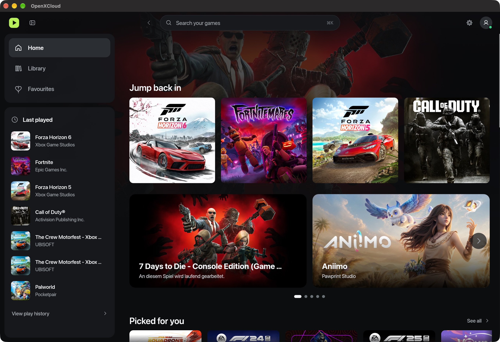

# ☁️ NexaCloud

### 🎮 Play beyond the browser.

**NexaCloud** is an independent, native Xbox Cloud Gaming client focused on performance, optimization, and a modern user experience.

Built upon the open-source [OpenXCloud](https://github.com/shyim/openxcloud) project, NexaCloud brings extensive modifications, a redesigned interface, and ongoing improvements to deliver a smoother cloud gaming experience beyond the browser.

---

## ✨ Features & Goals

- 🚀 Performance and compilation optimizations
- 🎨 Redesigned interface and visual identity
- 🖥️ Native desktop experience
- 🐧 Linux support
- 🪟 Windows support
- 📱 Mobile support in development
- ☁️ Xbox Cloud Gaming integration

*The project is actively evolving, and features and platform compatibility may change.*

## 🛠️ Technology

NexaCloud builds upon the original OpenXCloud architecture and its open-source technologies, with modifications and optimization work aimed at improving performance and compatibility.

## 📦 Platforms

| Platform | Status |
|---|---|
| 🐧 Linux | In development |
| 🪟 Windows | In development |
| 📱 Mobile | In development |

## 🙏 Credits

NexaCloud is based on **[OpenXCloud](https://github.com/shyim/openxcloud)**, originally created by [@shyim](https://github.com/shyim).

We sincerely thank the original developer and contributors for providing the foundation that made this project possible.

NexaCloud includes independent modifications, a redesigned interface, and additional development work.

## 📜 License

The original OpenXCloud project is licensed under **GNU GPL-3.0-only**.

NexaCloud respects the original project's licensing requirements. Please refer to the repository's license and preserved copyright notices for details.

## ⚠️ Disclaimer

NexaCloud is an independent community project. It is not affiliated with, endorsed by, or sponsored by Microsoft or Xbox.

---

# 🇧🇷 NexaCloud

### 🎮 Jogue além do navegador.

**NexaCloud** é um cliente nativo e independente do Xbox Cloud Gaming, desenvolvido com foco em desempenho, otimização e uma experiência moderna.

Baseado no projeto de código aberto [OpenXCloud](https://github.com/shyim/openxcloud), o NexaCloud apresenta modificações extensas, uma interface redesenhada e melhorias contínuas para proporcionar uma experiência de jogos na nuvem mais fluida, indo além do navegador.

---

## ✨ Recursos e objetivos

- 🚀 Otimizações de desempenho e compilação
- 🎨 Interface e identidade visual redesenhadas
- 🖥️ Experiência nativa para desktop
- 🐧 Suporte ao Linux
- 🪟 Suporte ao Windows
- 📱 Suporte para dispositivos móveis em desenvolvimento
- ☁️ Integração com o Xbox Cloud Gaming

*O projeto está em constante evolução, e os recursos e a compatibilidade das plataformas podem mudar.*

## 🛠️ Tecnologias

O NexaCloud utiliza como base a arquitetura original do OpenXCloud e suas tecnologias de código aberto, com modificações e otimizações voltadas à melhoria de desempenho e compatibilidade.

## 📦 Plataformas

| Plataforma | Situação |
|---|---|
| 🐧 Linux | Em desenvolvimento |
| 🪟 Windows | Em desenvolvimento |
| 📱 Celular | Em desenvolvimento |

## 🙏 Créditos

O NexaCloud é baseado no **[OpenXCloud](https://github.com/shyim/openxcloud)**, criado originalmente por [@shyim](https://github.com/shyim).

Agradecemos sinceramente ao desenvolvedor original e aos colaboradores pelo trabalho que tornou este projeto possível.

O NexaCloud possui modificações independentes, interface redesenhada e trabalho adicional de desenvolvimento.

## 📜 Licença

O projeto original OpenXCloud utiliza a licença **GNU GPL-3.0-only**.

O NexaCloud respeita os requisitos de licenciamento do projeto original. Consulte a licença do repositório e os avisos de direitos autorais preservados para mais informações.

## ⚠️ Aviso

O NexaCloud é um projeto independente da comunidade. Não possui afiliação, aprovação ou patrocínio da Microsoft ou Xbox.

---

<p align="center">
  ☁️ <strong>NexaCloud</strong><br>
  <i>Play beyond the browser.</i>
</p>


---

<div align="center">

# NexaCloud

**Xbox Cloud Gaming, right on your desktop.**

A native Rust client with a game-first library, GPU upscaling, and streaming stats you can actually use.

[Features](#made-for-playing) · [Get started](#get-started) · [Platform support](#platform-support) · [Contributing](CONTRIBUTING.md)

</div>



<p align="center"><sub>A screenshot of the running macOS app. Game artwork belongs to its respective owners.</sub></p>

## Made for playing

- **Your next game, easy to find.** Browse the cloud library, search by name, and narrow the list by genre, player count, touch support, or game features.
- **Pick up where you left off.** Recently played games live in the sidebar. Save favourites with a heart and get recommendations based on what you play.
- **Choose your output resolution.** Upscale to **1080p, 1440p, or 4K** with AMD FSR 1.0 or optional Apple MetalFX. Adjust sharpness and change the target while playing.
- **See what the stream is doing.** Check FPS, bitrate, network latency, and decode/GPU timings. Expand the overlay for recovery counters and 60-second performance graphs.
- **Play with your preferred controls.** Use a supported controller with rumble, **native xCloud keyboard and mouse** (real Windows VKey/mouse reports — no virtual gamepad needed), or the keyboard's virtual-controller mapping. Native keyboard/mouse is on by default and can be switched off in the in-game menu. In native mode, clicking the game surface **locks the cursor** and raw mouse motion turns the game camera like xCloud's F8 mode. Press **F8** to toggle keyboard/mouse on and off. Touch is native on Android.
- **A lateral in-game menu.** Press **F1** during a stream to open a PS5-style control-centre rail on the right: session timer, performance-stats toggle, native keyboard/mouse toggle, upscaling toggle and exit. Escape closes it. F1 and F8 are handled locally and never sent to the cloud PC.
- **Tune performance outside the game.** Settings → Streaming offers **30 / 60 / 120 / 240 fps** targets. Settings → Video lets you turn **VSync off** (immediate present, lowest latency) or on (fifo). The default is VSync on at 60 fps — the known-good configuration.
- **A native streaming stack.** webrtc-rs handles transport, H.264 and Opus handle video and audio, and wgpu renders the stream. Credentials stay in the operating system's credential store and survive restarts; a temporary network failure will not sign you out.

## Get started

**The first release is in preparation.** For now, build from source. Signed, self-contained installers are still pending.

You'll need a Microsoft/Xbox account with access to the games you want to stream and a working internet connection. Cloud availability depends on the game, account, and region.

### Build on macOS

Install [Rust through rustup](https://rustup.rs/) and the native build dependencies. From this repository's checkout:

```sh
brew install ffmpeg cmake pkg-config llvm
cargo run --locked --release -p xcloud-app
```

To include Apple's MetalFX upscaler:

```sh
cargo run --locked --release -p xcloud-app --features metalfx
```

Rustup selects the version pinned in [`rust-toolchain.toml`](rust-toolchain.toml). The built application binary is `target/release/openxcloud`.

See the [packaging guide](PACKAGING.md) for Linux prerequisites and native packages. GitHub Actions produces macOS `.app` archives, Linux `.deb` packages, a Windows `.exe` ZIP and an Android `.apk`. Development binaries still require their native runtime libraries.

### Start playing

1. Open NexaCloud and sign in with Microsoft in the browser window that opens — no device code, no code to type. Your session is saved on the device and restored automatically next time.
2. Pick a game from your library and press **Play**.
3. Open **Settings → Video & upscaling** to choose the upscaler and output resolution.
4. Enable the performance overlay with **⌘⇧I** on macOS or **Ctrl+Shift+I**. Expand **Detailed stats** for graphs and counters.
5. During a game press **F1** for the lateral menu: session time, stats, native input and upscale toggles. **F8** toggles keyboard/mouse mode; click the game to lock the cursor for camera control. Escape closes the menu.

Local upscaling preserves the source aspect ratio and never downscales a larger source. Streaming resolution and local output resolution are separate settings.

## Platform support

| Platform | Current status | Video path |
| --- | --- | --- |
| **macOS** | Primary development platform; app packaging available; signing and clean-machine validation pending | VideoToolbox with FFmpeg fallback; FSR 1.0 and optional MetalFX |
| **Linux** | Workspace compilation checked; desktop and live-stream validation ongoing | FFmpeg and wgpu; FSR 1.0 |
| **Windows** | Native build in CI; produces `openxcloud.exe` in a release ZIP (unsigned) | FFmpeg and wgpu; FSR 1.0 |
| **Android** | WebView APK with native touch for the official xCloud player (not the Rust renderer) | Microsoft web player, hardware-accelerated |

The repository includes desktop CI checks for macOS/Linux/Windows, transport tests for all three desktop platforms, and an Android APK build. Build and loopback checks are only part of release validation.

## Under the hood

OpenXCloud uses **Rust**, **egui/eframe**, **wgpu**, and **webrtc-rs**. The workspace separates authentication, protocol handling, transport, media decoding, rendering, and input so each part can be tested independently.

- [Contributor guide](CONTRIBUTING.md) — workspace structure and development checks.

Bug reports are welcome. Include the app version, OS/GPU, and steps to reproduce. Review logs before sharing them and leave out credentials and account information.

## Licence

OpenXCloud is licensed under **[GPL-3.0-only](LICENSE)**. Third-party components retain their respective licences; see [third-party notices](THIRD_PARTY_NOTICES.md).

OpenXCloud is an independent project, unaffiliated with Microsoft or Xbox. Xbox and game names, logos, and artwork belong to their respective owners.
